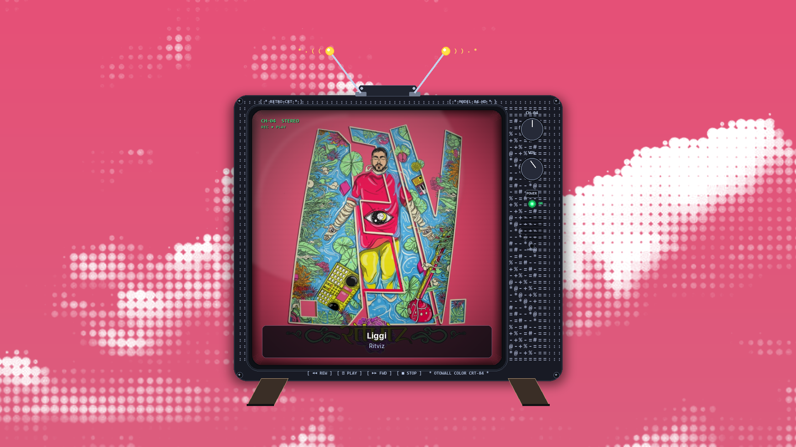
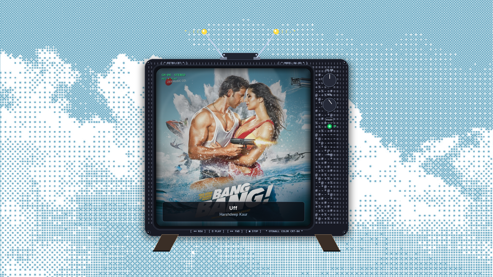
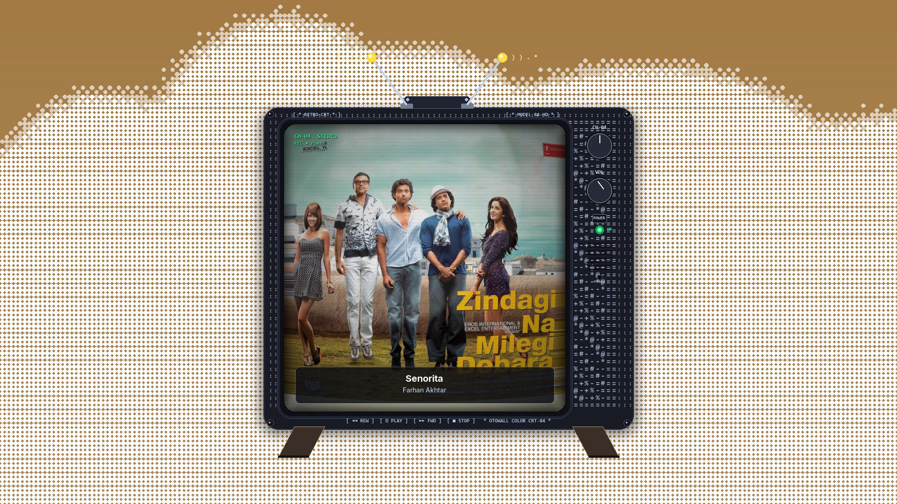

<div align="center">

# 📺 OtoWall
### Real-Time Retro CRT & Glass Album Art Wallpaper Engine

[](https://pypi.org/project/otowall/)
[](https://pypi.org/project/otowall/)
[](https://github.com/codewithevilxd/OtoWall/actions/workflows/ci.yml)
[](https://github.com/CodewithEvilxd/OtoWall/blob/master/LICENSE)
[](https://www.python.org/downloads/)
[](#-quick-start)
[](https://github.com/astral-sh/ruff)

**A high-performance dynamic wallpaper daemon that brings whatever track you are playing on Spotify or local media players into live desktop art.**  
Features realistic **1980s Retro CRT television physics** (barrel bulge curvature, phosphor scanlines, RGB triads, antenna glow) and **curated comic/manga cloudscape backgrounds**, with seamless zero-trace wallpaper restoration when paused.

```bash
# ⚡ 1-Line Quickstart (Windows PowerShell)
.\scripts\run.ps1
```

[✨ Key Features](#-key-features) • [🖼️ Showcase Gallery](#-showcase-gallery) • [📺 CRT Physics Engine](#-retro-crt-television-physics-engine) • [⚡ Quick Start](#-quick-start) • [📖 Command Reference](#-command-line-reference) • [⚙️ Configuration](#-configuration--environment-variables) • [🏗️ Architecture](#-architecture--repository-structure) • [🛠️ Developer Tools](#-developer-tooling)

</div>

---

## 🖼️ Showcase Gallery

| Style 1: Pop-Art Halftone Screen Clouds | Style 2: Manga Screentone Dither Clouds | Style 3: Retro ASCII Bayer Dither Clouds |
|:---:|:---:|:---:|
| **Liggi — Ritviz** | **Uff — Harshdeep Kaur** | **Senorita — ZNMD** |
| [](https://github.com/CodewithEvilxd/OtoWall/blob/master/docs/wallpapers/wallpaper_liggi_ritviz.png) | [](https://github.com/CodewithEvilxd/OtoWall/blob/master/docs/wallpapers/wallpaper_uff_bang_bang.png) | [](https://github.com/CodewithEvilxd/OtoWall/blob/master/docs/wallpapers/wallpaper_senorita_znmd.png) |
| *Adaptive palette halftone dot matrix* | *High-density 45° diagonal screentone* | *8x8 Bayer ordered retro ASCII threshold* |

> 💡 *All showcase wallpapers are rendered dynamically in real-time at 1080p / 1440p / 4K resolutions based on currently playing tracks.*

---

## 📺 Retro CRT Television Physics Engine

Behind the retro aesthetic is a physics-based simulation of vintage cathode ray tubes:

- **Spherical Glass Bulb Curvature**: Vectorized non-linear radial transformation with coordinate distortion factor $k = 0.08$ calculated via fast NumPy arrays:
  $$r_{\text{distorted}} = r \times (1 + k \cdot r^2)$$
- **RGB Phosphor Aperture Grille**: Alternating red, green, and blue micro-stripe phosphor masks simulating Trinitron-style displays.
- **Horizontal Cathode Retrace Scanlines**: Sinusoidal horizontal electron beam darkening with 15% scanline depth.
- **3D Inner Bevel Drop Shadow**: 24px multi-stop recessed screen cavity shadow providing depth behind the outer bezel.
- **Curved Glass Specular Highlights**: Dual-arc white glare highlights along top-left and top-right glass curvature.
- **Phosphor Green OSD**: Retro glowing on-screen display indicator (`CH-04 STEREO  ● PLAY`).
- **Tactile Hardware Details**: Twin rotary dials (Channel & Volume), active emerald power LED, brass-tipped rabbit-ear antennas, wooden stance feet, and a smoked acrylic track info card.

---

## ✨ Key Features

- 📺 **Dual Compositor Engines**:
  - `ascii_crt`: Retro 1980s color CRT television with physical barrel curvature and dithered cloudscape backdrops.
  - `glass`: Modern frosted liquid-glass panel with adaptive contrast and blurred backdrop.
- ☁️ **3 Curated Cloudscape Styles**:
  - *Pop-Art Halftone*: Dot-matrix screens adapting dynamically to the album art palette.
  - *Manga Screentone*: Japanese comic aesthetic with 45° high-density screen dither and deep shadow zones.
  - *Retro ASCII Bayer*: Nostalgic 8×8 Bayer matrix ordered dithering with ASCII character density.
- 🎵 **Universal Playback Providers**:
  - **Windows**: Zero-config local listening via Windows System Media Transport Controls (SMTC WinRT).
  - **Linux**: D-Bus MPRIS (`org.mpris.MediaPlayer2.*`) session listener.
  - **macOS**: AppleScript automation bridge for Spotify.app.
  - **Spotify Web API**: Cross-device remote listening via PKCE OAuth (works even if music is playing on phone, web, or smart speakers).
- 🎨 **High-Resolution Album Art Pipeline**:
  - Automatically upgrades low-res embedded system thumbnails to pristine uncompressed $1000\times1000$ artwork via asynchronous **Apple iTunes Search API** queries.
  - Offline mode support (`--no-online-art`) for zero network footprint.
- 🛡️ **Zero-Trace Wallpaper Restoration**:
  - Snapshots original wallpaper on startup.
  - Automatically restores your desktop wallpaper within seconds when music is paused, stopped, or the program exits (`Ctrl+C`).
- 🖥️ **Multi-Monitor & High-DPI Aware**:
  - Native Windows COM `IDesktopWallpaper` integration with virtual desktop spanning and per-monitor positioning.
- ⚡ **Lightweight & Battery Efficient**:
  - Vectorized array operations via NumPy.
  - Bounded on-disk cache in `%APPDATA%\otowall\cache` to avoid repeated re-composition of unchanged tracks.
  - OS-level single-instance mutex prevents redundant background processes.

---

## ⚡ Quick Start

### Windows (Recommended)

#### Option 1: Standalone 1-Click Scripts (Repo)
```powershell
# 1. Run live retro CRT wallpaper daemon
.\scripts\run.ps1

# 2. Run full automated test suite
.\scripts\test.ps1

# 3. Build standalone Windows .exe
.\scripts\build.ps1
```

#### Option 2: Install via pipx / pip
```powershell
pipx install otowall
otowall run --source local --style ascii_crt
```

#### Option 3: Install from Source
```powershell
git clone https://github.com/codewithevilxd/OtoWall.git
cd OtoWall
python -m venv .venv
.\.venv\Scripts\Activate.ps1
pip install -e ".[dev,windows]"
otowall run --source local --style ascii_crt
```

---

### Linux
```bash
python3.12 -m venv .venv
source .venv/bin/activate
pip install -e ".[linux]"
otowall run --source local --style ascii_crt
```
*Supports GNOME (`gsettings`), KDE (`plasma-apply-wallpaperimage`), XFCE (`xfconf-query`), and standalone WMs via `feh`, `swaybg`, or `nitrogen`.*

---

### macOS
```bash
python3.12 -m venv .venv
source .venv/bin/activate
pip install -e ".[macos]"
otowall run --source local --style ascii_crt
```
*Supports macOS Sonoma / Sequoia per-display wallpaper control via Cocoa AppKit and AppleScript.*

---

## 📖 Command-Line Reference

The application exposes both `otowall` and `now-playing` aliases:

```bash
otowall [COMMAND] [OPTIONS]
```

### Commands

| Command | Description | Example |
|---|---|---|
| `run` | Polls playback and dynamically renders & sets desktop wallpaper | `otowall run --source local --style ascii_crt` |
| `restore` | Restores original wallpaper saved at session start | `otowall restore` |
| `login` | Interactive Spotify Web API OAuth authentication | `otowall login your_username` |
| `diag` | *(Windows only)* Inspects displays, DPI scaling, playback sources, and active locks | `otowall diag` |
| `autostart` | Configures system startup (Windows Run key, Linux XDG, macOS LaunchAgent) | `otowall autostart enable --source local` |

### `otowall run` Flags

| Flag | Default | Description |
|---|---|---|
| `--style {ascii_crt, glass}` | `glass` | Visual theme (`ascii_crt` for retro CRT TV, `glass` for liquid glass card) |
| `--source {local, spotify, auto}` | `auto` | Playback listener source (`local` for OS media session, `spotify` for Web API) |
| `--poll-interval SECONDS` | `1.0` | Time interval between playback checks (0.5s to 2.0s) |
| `--once` | `false` | Executes a single composition/apply cycle and exits immediately |
| `--no-online-art` | `false` | Disables remote iTunes lookups; relies strictly on offline system thumbnails |
| `--cache-dir PATH` | `%APPDATA%\otowall\cache` | Custom directory for rendered wallpaper cache |
| `--env-file PATH` | `.env` | Path to custom `.env` file |
| `-v`, `--verbose` | `false` | Enables detailed debug logging |

---

## ⚙️ Configuration & Environment Variables

Settings can be specified via command-line flags, environment variables, or a `.env` file:

| Variable | Default | Purpose |
|---|---|---|
| `NOW_PLAYING_SOURCE` | `auto` | Preferred audio playback provider (`local`, `spotify`, or `auto`) |
| `NOW_PLAYING_ONLINE_ART` | `1` | Set `0` to disable Apple iTunes high-res artwork queries |
| `SPOTIPY_CLIENT_ID` | `""` | Spotify Developer Client ID (required only for Spotify Web API mode) |
| `SPOTIPY_CLIENT_USERNAME` | `""` | Spotify account username for token cache storage |
| `SPOTIPY_REDIRECT_URI` | `http://127.0.0.1:8897/callback` | OAuth redirect URI registered in Spotify Developer Dashboard |
| `NOW_PLAYING_COMPOSE_VERIFY` | `0` | Set `1` to run optional background contrast & composition quality verifications |

---

## 🏗️ Architecture & Repository Structure

```
nowPlayingDesktops/
├── .github/                      # CI/CD Workflows, Community Standards & Security
│   ├── ISSUE_TEMPLATE/           # Structured bug report & feature request forms
│   ├── workflows/                # Automated GitHub Actions test & release pipelines
│   ├── pull_request_template.md  # Standard pull request checklist
│   └── SECURITY.md               # Security disclosure & vulnerability reporting policy
├── docs/                         # Project Documentation & Media Portal
│   ├── wallpapers/               # 1080p showcase gallery & CRT specifications
│   │   ├── wallpaper_liggi_ritviz.png       # Style 1: Pop-Art Halftone Screen Clouds
│   │   ├── wallpaper_uff_bang_bang.png      # Style 2: Manga Screentone Dither Clouds
│   │   ├── wallpaper_senorita_znmd.png      # Style 3: Retro ASCII Bayer Dither Clouds
│   │   └── README.md
│   ├── ARCHITECTURE.md           # Architectural deep dive, data flow, & CRT simulation math
│   ├── CONTRIBUTING.md           # Development environment setup & contributing guidelines
│   ├── CHANGELOG.md              # Version 1.1.0 and historical release log
│   └── README.md                 # Documentation portal index
├── scripts/                      # Developer Utilities, Packaging & Automation
│   ├── packaging/                # PyInstaller packaging specs & Windows bootstrap
│   │   ├── otowall-windows.spec  # Production Windows standalone .exe bundle
│   │   ├── otowall-smoke.spec    # CI smoke build spec
│   │   ├── pyinstaller_win_entry.py # High-DPI Windows runtime bootstrap
│   │   └── README.md             # Packaging documentation
│   ├── build.ps1                 # One-click Windows .exe builder
│   ├── run.ps1                   # One-click local live runner
│   ├── test.ps1                  # One-click pytest test runner
│   ├── generate_showcase_wallpapers.py # Automated iTunes art fetcher & wallpaper generator
│   ├── profile_compose.py        # Composition latency & performance profiler
│   ├── requirements-lock.txt     # Reproducible environment lock file
│   └── README.md                 # Developer tooling documentation
├── src/otowall/                  # Core Application Package
│   ├── assets/                   # Bundled cloud reference textures & icons
│   ├── fonts/                    # Bundled typography
│   ├── platforms/                # OS wallpaper managers (Windows COM, Linux D-Bus, macOS AppKit)
│   ├── sources/                  # Media listeners (Windows SMTC, Linux MPRIS, macOS AppleScript)
│   ├── verification/             # Visual & contrast validation suites
│   ├── ascii_composer.py         # Retro CRT TV & cloudscape engine (NumPy vectorized math)
│   ├── composer.py               # Frosted liquid-glass wallpaper compositor
│   ├── runner.py                 # Core event loop, mutex control, & wallpaper lifecycle
│   └── cli.py                    # Command-line entry points (`otowall`, `now-playing`)
├── tests/                        # Comprehensive unit, integration, and platform tests
├── .editorconfig                 # Multi-editor code formatting
├── .env.example                  # Environment configuration template
├── .gitignore                    # Pristine git ignore (no caches/logs)
├── LICENSE                       # GNU General Public License v3.0 (GPL-3.0)
└── pyproject.toml                # PEP 621 build system, dependencies, and tool settings
```

---

## 🛠️ Developer Tooling

### Running Tests
All tests are executed via Pytest. Mocking guarantees your actual desktop wallpaper is never altered during testing:

```powershell
# Using the convenience script
.\scripts\test.ps1

# Or directly via pytest
pytest -q
```

### Code Quality & Formatting
```bash
ruff check src tests scripts
ruff format src tests scripts
```

### Benchmarking Compositor Performance
Measure composition latency at high-DPI laptop resolution ($2496 \times 1664$):
```bash
python scripts/profile_compose.py
```

---

## ❓ Troubleshooting & Diagnostics

- **Run Diagnostics**:
  ```powershell
  otowall diag -v
  ```
  Inspects active audio sessions, monitor pixel dimensions, virtual span bounds, registry keys, and single-instance mutex state.
- **Log Files**:
  Rotating logs are maintained under your OS configuration path:
  - **Windows**: `%APPDATA%\otowall\logs\otowall.log`
  - **Linux**: `~/.config/otowall/logs/otowall.log`
  - **macOS**: `~/Library/Application Support/otowall/logs/otowall.log`
- **Another instance active error**:
  OtoWall enforces a single active background process via the Windows mutex `Local\otowall-run` (or PID lockfile on Linux/macOS). If a previous run did not exit, terminate it or check Task Manager for `otowall.exe`.

---

## ⚖️ License

OtoWall is licensed under the **GNU General Public License v3.0 (GPL-3.0)**.  
See the [LICENSE](LICENSE) file for the full license text.

Copyright (C) 2026 **codewithevilxd** &lt;codewithevilxd@gmail.com&gt;.
