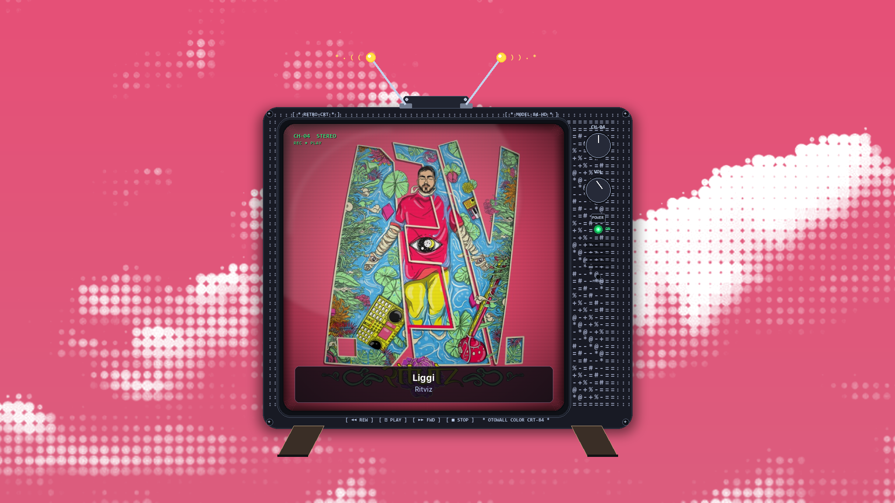
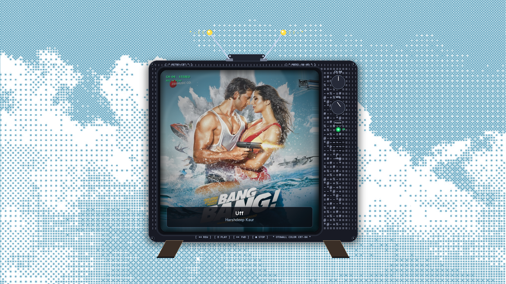
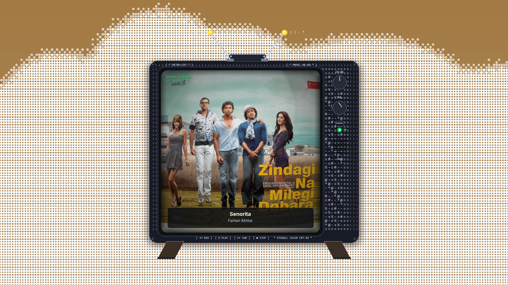

# Showcase Wallpapers

High-resolution (1920×1080) desktop wallpapers rendered with OtoWall's **Retro CRT Television & Cloudscape Engine**.

---

## Gallery

| Style 1: Pop-Art Halftone Screen Clouds | Style 2: Manga Screentone Dither Clouds | Style 3: Retro ASCII Bayer Dither Clouds |
|:---:|:---:|:---:|
| **Liggi — Ritviz** | **Uff — Harshdeep Kaur** | **Senorita — ZNMD** |
| [](wallpaper_liggi_ritviz.png) | [](wallpaper_uff_bang_bang.png) | [](wallpaper_senorita_znmd.png) |
| `wallpaper_liggi_ritviz.png` | `wallpaper_uff_bang_bang.png` | `wallpaper_senorita_znmd.png` |

---

## Curated Styles Overview

### 1. Pop-Art Halftone Screen Clouds
- **Visual Motif**: Inspired by mid-century pop-art and comic print halftoning.
- **Algorithm**: Staggered hexagonal dot matrix where dot radii modulate proportionally to local cloud luminosity.
- **Palette**: Harmonized dynamically with the album artwork's dominant color palette.

### 2. Manga Screentone Dither Clouds
- **Visual Motif**: Classic Japanese manga screentone aesthetic.
- **Algorithm**: High-density 45° diagonal halftone screening creating subtle, paper-like tonal gradients.
- **Palette**: Deep tinted shadow zones combined with crisp, high-contrast white cloud rims.

### 3. Retro ASCII Bayer Dither Clouds
- **Visual Motif**: 1980s retrocomputing and terminal art.
- **Algorithm**: Pure 8×8 Bayer ordered dithering crossed with an ASCII density font matrix.
- **Palette**: Nostalgic 4-color CGA/EGA styled tinting.

---

## CRT Television Simulation Specifications

Each wallpaper features a simulated retro 1980s color CRT television screen:

- **Vectorized Barrel Distortion**: Non-linear coordinate transformation ($\text{bulge}=0.08$) bending the album cover outwards across a physical curved cathode glass bulb.
- **Aperture Grille Triads**: Alternating red, green, and blue phosphor micro-stripes across every vertical column.
- **Horizontal Electron Scanlines**: Darkened cathode retrace lines with 15% scanline depth.
- **Curved Glass Specular Highlights**: Dual-arc white specular reflections on the top-left and top-right glass curvature.
- **Phosphor OSD**: Glowing retro-green on-screen display (`CH-04 STEREO  ● PLAY`).
- **3D Recessed Screen Bevel**: 24px deep inner multi-stop drop shadow creating a physical recessed tube cavity.
- **Chassis & Hardware**:
  - Twin tactile rotary dials (Channel & Volume).
  - Power indicator LED (glowing phosphor emerald).
  - Dual angled metallic rabbit-ear antenna rods with brass receiver balls.
  - Angled wooden/chassis stance legs with floor cast shadows.
  - Lower-third smoked acrylic translucent song title card.

---

## Generating Custom Wallpapers

To generate new showcase wallpapers or render your own favorites:

```bash
python scripts/generate_showcase_wallpapers.py
```
